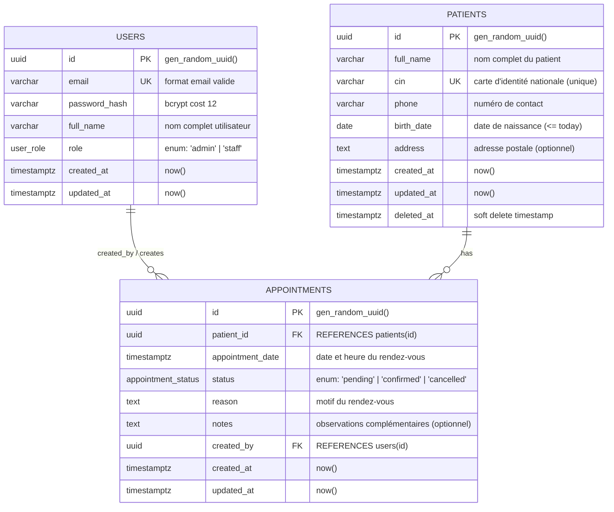

# Conception Technique & Architecture Base de Données — ClinicFlow

Ce document détaille la conception architecturale, le modèle de données, les contraintes relationnelles, les stratégies d'indexation, de concurrence et de sécurité pour l'application **ClinicFlow**.

---

## 1. Modèle Entité-Association (ERD)



---

## 2. Analyse et Justification des Relations

### 2.1 Relation `PATIENTS` ➔ `APPOINTMENTS` (1-N)
- **Type :** Un-à-Plusieurs (1 à N).
- **Justification :** 
  - Un patient peut prendre plusieurs rendez-vous au fil du temps (consultations initiales, suivis, contrôles).
  - À l'inverse, un rendez-vous donné concerne obligatoirement un et un seul patient identifié.
  - La clé étrangère `patient_id` est donc hébergée directement dans la table `appointments`.

### 2.2 Relation `USERS` ➔ `APPOINTMENTS` (1-N)
- **Type :** Un-à-Plusieurs (1 à N).
- **Justification :** 
  - Un utilisateur de la clinique (secrétaire, réceptionniste, praticien, administrateur) peut enregistrer de multiples rendez-vous dans le système.
  - Chaque rendez-vous conserve la traçabilité de son auteur (`created_by`), qui pointe vers un unique utilisateur.

### 2.3 Pourquoi n'y a-t-il pas de relation N-N (Plusieurs-à-Plusieurs) ?
- Une relation N-N (nécessitant une table de jointure associative) serait justifiée si :
  1. Un rendez-vous était une consultation de groupe réunissant plusieurs patients distincts simultanément (ex. thérapie de groupe).
  2. Un rendez-vous impliquait une équipe de plusieurs praticiens indépendants (ex. `appointment_practitioners`).
  3. Il existait une relation d'attribution durable et multiple de praticiens référents par patient indépendante des créneaux (ex. `patient_doctors`).
- **Dans le cadre clinique de ClinicFlow :**
  - Les rendez-vous sont des créneaux individuels (1 créneau = 1 patient).
  - La table `appointments` joue elle-même le rôle de table centrale d'événements reliant l'acteur du système (`users`) et le sujet du soin (`patients`).
  - L'introduction d'une table intermédiaire N-N ajouterait une complexité inutile sans justification métier.

---

## 3. Schéma Détaillé des Tables, Types et Contraintes

### 3.1 Énumérations PostgreSQL (Custom Types)

```sql
CREATE TYPE user_role AS ENUM ('admin', 'staff');
CREATE TYPE appointment_status AS ENUM ('pending', 'confirmed', 'cancelled');
```

---

### 3.2 Table `users`

| Colonne | Type PostgreSQL | Contraintes | Description |
| :--- | :--- | :--- | :--- |
| `id` | `UUID` | `PRIMARY KEY DEFAULT gen_random_uuid()` | Identifiant unique universel |
| `email` | `VARCHAR(255)` | `NOT NULL UNIQUE` | Adresse email normalisée (lowercase) |
| `password_hash` | `VARCHAR(255)` | `NOT NULL` | Hash de mot de passe (Bcrypt cost 12) |
| `full_name` | `VARCHAR(120)` | `NOT NULL` | Nom et prénom de l'agent |
| `role` | `user_role` | `NOT NULL DEFAULT 'staff'` | Rôle applicatif |
| `created_at` | `TIMESTAMPTZ` | `NOT NULL DEFAULT now()` | Horodatage de création |
| `updated_at` | `TIMESTAMPTZ` | `NOT NULL DEFAULT now()` | Horodatage de mise à jour |

**Contraintes CHECK :**
- `CHECK (email ~* '^[A-Za-z0-9._%+-]+@[A-Za-z0-9.-]+\.[A-Za-z]{2,}$')` : Validation structurelle basique de l'adresse email.
- `CHECK (length(trim(full_name)) >= 2)` : Évite les chaînes vides ou remplies d'espaces blancs.

---

### 3.3 Table `patients`

| Colonne | Type PostgreSQL | Contraintes | Description |
| :--- | :--- | :--- | :--- |
| `id` | `UUID` | `PRIMARY KEY DEFAULT gen_random_uuid()` | Identifiant unique universel |
| `full_name` | `VARCHAR(150)` | `NOT NULL` | Nom complet du patient |
| `cin` | `VARCHAR(20)` | `NOT NULL` *(UNIQUE partiel ou direct)* | Carte d'Identité Nationale |
| `phone` | `VARCHAR(30)` | `NOT NULL` | Téléphone joignable |
| `birth_date` | `DATE` | `NOT NULL` | Date de naissance |
| `address` | `TEXT` | `NULL` | Adresse physique optionnelle |
| `created_at` | `TIMESTAMPTZ` | `NOT NULL DEFAULT now()` | Horodatage de création |
| `updated_at` | `TIMESTAMPTZ` | `NOT NULL DEFAULT now()` | Horodatage de mise à jour |
| `deleted_at` | `TIMESTAMPTZ` | `NULL` | Timestamp d'archivage (Soft Delete) |

**Contraintes CHECK & Unicité :**
- `CHECK (birth_date <= CURRENT_DATE)` : Interdit toute date de naissance future.
- `CHECK (birth_date >= '1900-01-01')` : Cohérence calendaire minimale.
- `CHECK (length(trim(full_name)) >= 2)` : Nom non vide.
- `CHECK (length(trim(cin)) >= 2)` : CIN non vide.
- **Unicité du CIN conditionnelle (avec Soft Delete) :**
  ```sql
  CREATE UNIQUE INDEX uq_patients_cin_active ON patients (cin) WHERE deleted_at IS NULL;
  ```
  *(Permet de ré-inscrire un patient si son ancien profil a été archivé, ou garantit l'unicité stricte sur les fiches actives).*

---

### 3.4 Table `appointments`

| Colonne | Type PostgreSQL | Contraintes | Description |
| :--- | :--- | :--- | :--- |
| `id` | `UUID` | `PRIMARY KEY DEFAULT gen_random_uuid()` | Identifiant unique universel |
| `patient_id` | `UUID` | `NOT NULL REFERENCES patients(id) ON DELETE RESTRICT` | Patient concerné |
| `appointment_date` | `TIMESTAMPTZ` | `NOT NULL` | Date et heure de début du RDV |
| `status` | `appointment_status`| `NOT NULL DEFAULT 'pending'` | Statut du rendez-vous |
| `reason` | `TEXT` | `NOT NULL` | Motif de consultation |
| `notes` | `TEXT` | `NULL` | Commentaires ou observations médicales |
| `created_by` | `UUID` | `NOT NULL REFERENCES users(id) ON DELETE RESTRICT` | Agent créateur |
| `created_at` | `TIMESTAMPTZ` | `NOT NULL DEFAULT now()` | Horodatage de création |
| `updated_at` | `TIMESTAMPTZ` | `NOT NULL DEFAULT now()` | Horodatage de mise à jour |

**Contraintes CHECK :**
- `CHECK (length(trim(reason)) >= 3)` : Motif significatif obligatoire.

---

## 4. Règles d'Intégrité Référentielle (ON DELETE)

| Clé Étrangère | Cible | Règle retenue | Justification détaillée |
| :--- | :--- | :--- | :--- |
| `appointments.patient_id` | `patients(id)` | **`RESTRICT`** | **Dossier médical critique :** La suppression physique en cascade (`CASCADE`) d'un patient détruirait l'historique médico-légal et les rendez-vous passés sans confirmation explicite. `RESTRICT` empêche tout effacement accidentel d'un patient tant que des rendez-vous lui sont rattachés. Dans le cadre de l'application, l'admin procède à un **soft delete** (`deleted_at`) ou doit explicitement traiter les rendez-vous avant toute purge. |
| `appointments.created_by` | `users(id)` | **`RESTRICT`** | **Traçabilité et audit d'accès :** Si un membre du personnel quitte la clinique ou est supprimé, ses actions passées (création de rendez-vous) ne doivent ni être détruites en cascade (`CASCADE`), ni perdre leur auteur (`SET NULL`), car `created_by` est `NOT NULL`. La règle `RESTRICT` force la désactivation d'un compte utilisateur plutôt que sa suppression physique. |

---

## 5. Stratégie d'Indexation et Optimisation des Performances

### 5.1 Recherche de Patients (`fullName` & `CIN`)
Dans la liste des patients, le paramètre `?search=` permet de filtrer simultanément sur le nom complet et sur le numéro de CIN.

1. **Indexation Trigramme (`pg_trgm`) :**
   Les recherches textuelles partielles ou insensibles à la casse (`ILIKE '%terme%'`) rendent les index B-Tree inopérants lorsque le terme ne commence pas au début de la chaîne.
   ```sql
   CREATE EXTENSION IF NOT EXISTS pg_trgm;

   -- Index GIN trigramme pour la recherche textuelle floue et sous-chaîne sur full_name
   CREATE INDEX idx_patients_full_name_trgm ON patients USING gin (full_name gin_trgm_ops);

   -- Index GIN trigramme sur CIN pour recherche partielle rapide
   CREATE INDEX idx_patients_cin_trgm ON patients USING gin (cin gin_trgm_ops);
   ```
2. **Index B-Tree sur `cin` :**
   L'index B-Tree unique `uq_patients_cin_active` couvre déjà les recherches par égalité exacte (`WHERE cin = '...'`).

### 5.2 Filtres des Rendez-vous (`appointment_date`, `status`, `patient_id`)
1. **Index Composite pour l'API et le Dashboard :**
   La route `GET /api/appointments?date=YYYY-MM-DD&status=confirmed` et les compteurs du tableau de bord exécutent des filtres combinés temporels et d'état :
   ```sql
   CREATE INDEX idx_appointments_date_status ON appointments (appointment_date, status);
   ```
2. **Index pour la fiche patient :**
   La consultation `GET /api/patients/:id` liste l'historique des rendez-vous triés par date décroissante :
   ```sql
   CREATE INDEX idx_appointments_patient_date ON appointments (patient_id, appointment_date DESC);
   ```
3. **Index Partiel pour la règle des 30 minutes :**
   Afin de vérifier quasi-instantanément l'existence de conflits pour les rendez-vous confirmés :
   ```sql
   CREATE INDEX idx_appointments_patient_confirmed ON appointments (patient_id, appointment_date)
   WHERE status = 'confirmed';
   ```

---

## 6. Analyse du Soft Delete (`deleted_at`)

### 6.1 Avantages
- **Conformité & Valeur Légale :** Les données médicales ne peuvent pas être supprimées arbitrairement. Le soft delete conserve une piste d'audit intacte.
- **Réversibilité sans restauration de backup :** Possibilité d'annuler une erreur de manipulation humaine immédiatement via un simple `UPDATE ... SET deleted_at = NULL`.
- **Intégrité Référentielle Non Brisée :** Les clés étrangères (`appointments.patient_id`) continuent de pointer vers une ligne physique valide.

### 6.2 Inconvénients
- **Complexité applicative :** Toutes les requêtes de lecture doivent inclure la clause `WHERE deleted_at IS NULL`. L'oubli de ce filtre dans une requête expose des données supprimées.
- **Gestion des contraintes uniques :** Un index `UNIQUE(cin)` bloquerait la création d'un nouveau patient si un ancien patient supprimé possédait déjà ce CIN. *(Résolu par un index unique partiel `WHERE deleted_at IS NULL`)*.
- **Volume et fragmentation :** Les données "mortes" s'accumulent dans les tables et index principaux, augmentant l'empreinte disque.

### 6.3 Recommandation
- **Adoption ciblée du Soft Delete sur `patients` :**
  - La table `patients` comportera la colonne `deleted_at TIMESTAMPTZ NULL`.
  - L'index unique sur `cin` est conditionné à `WHERE deleted_at IS NULL`.
  - Dans le code TypeScript / Drizzle, les méthodes de repository encapsulent ce filtrage (`and(eq(patients.id, id), isNull(patients.deletedAt))`).
- **Pour `appointments` :**
  - Pas de soft delete requis : le cycle de vie métier dispose déjà de l'état explicite `status = 'cancelled'`.

---

## 7. Règle Métier : "Pas 2 RDV confirmés à moins de 30 minutes pour un même patient"

### 7.1 Définition du Conflit Temporel
Deux rendez-vous confirmés $A$ et $B$ d'un patient sont en conflit si :
$$| appointmentDate_A - appointmentDate_B | < 30 \text{ minutes}$$
Soit en SQL :
```sql
appointment_date BETWEEN (NouveauRDV - INTERVAL '30 minutes') AND (NouveauRDV + INTERVAL '30 minutes')
```

---

### 7.2 Comparatif des Solutions Techniques

| Option | Fonctionnement | Avantages | Inconvénients |
| :--- | :--- | :--- | :--- |
| **Option A : Advisory Lock (`pg_advisory_xact_lock`)** | Verrou transactionnel applicatif basé sur un hash de l'identifiant patient : `pg_advisory_xact_lock(hashtext(patientId::text))` | - Léger, n'écrit pas sur disque.<br>- Libéré automatiquement au `COMMIT`/`ROLLBACK`.<br>- Ne bloque que les créations relatives au patient ciblé. | - Règle appliquée uniquement si le code appelle le lock.<br>- Possibilité de collisions théoriques de hash (minime avec 64 bits). |
| **Option B : Verrou Ligne Patient (`SELECT FOR UPDATE`)** | Au début de la transaction de réservation, on exécute `SELECT id FROM patients WHERE id = $1 FOR UPDATE`. | - Standard SQL universel.<br>- Sérialise strictement toutes les modifications de RDV pour ce patient.<br>- Simple à appréhender et très robuste. | - Nécessite l'existence de la ligne patient.<br>- Verrouille la ligne patient pendant la transaction (empêche un update concurrent du profil patient). |
| **Option C : Contrainte d'Exclusion Postgres (`EXCLUDE USING gist`)** | Contrainte native au niveau moteur Postgres :<br>`EXCLUDE USING gist (patient_id WITH =, tstzrange(appointment_date - interval '30 minutes', appointment_date + interval '30 minutes') WITH &&) WHERE (status = 'confirmed')` | - Garantie mathématique absolue au niveau moteur DB (ACID).<br>- Impossible à contourner, même par un script SQL direct.<br>- Zéro race condition possible. | - Nécessite l'extension `btree_gist`.<br>- Support complexe dans les migrations Drizzle (nécessite du raw SQL).<br>- Messages d'erreurs Postgres bruts à intercepter et parser. |

---

### 7.3 Recommandation d'Architecture (Défense en Profondeur)
La recommandation d'excellence pour un projet de niveau production allie :
1. **Au niveau Service (Backend) :**
   - Exécution dans une transaction de base de données.
   - Verrouillage ciblé de la ressource patient avec **`SELECT id FROM patients WHERE id = $1 FOR UPDATE`** (ou `pg_advisory_xact_lock`).
   - Vérification de l'existence d'un RDV en conflit :
     ```sql
     SELECT 1 FROM appointments
     WHERE patient_id = $1
       AND status = 'confirmed'
       AND id != $currentAppointmentId -- Si update
       AND appointment_date > ($newDate - INTERVAL '30 minutes')
       AND appointment_date < ($newDate + INTERVAL '30 minutes')
     LIMIT 1;
     ```
   - Si un conflit est détecté, levée d'une `AppError(409, "Un rendez-vous confirmé existe déjà dans une fenêtre de 30 minutes pour ce patient")`.
2. **Au niveau Base de Données (Filet de Sécurité) :**
   - Ajout d'une contrainte d'exclusion `EXCLUDE USING gist` avec `btree_gist` pour garantir l'intégrité même en cas de modification directe ou de faille applicative concurrente.

---

## 8. Spécification des Endpoints de l'API REST

### 8.1 Authentification (`/api/auth`)

| Méthode | Route | Rôles Autorisés | Statuts HTTP | Description & Validation |
| :--- | :--- | :--- | :--- | :--- |
| `POST` | `/api/auth/login` | Public | `200 OK`<br>`400 Bad Request`<br>`401 Unauthorized`<br>`429 Too Many Requests` | Connexion par email et mot de passe. Retourne `{ user: { id, email, fullName, role }, token }`. Rate limiting activé. |
| `GET` | `/api/auth/me` | `admin`, `staff` | `200 OK`<br>`401 Unauthorized` | Récupère le profil de l'utilisateur connecté via le token JWT bearer. |

---

### 8.2 Gestion des Patients (`/api/patients`)

| Méthode | Route | Rôles Autorisés | Statuts HTTP | Description & Validation |
| :--- | :--- | :--- | :--- | :--- |
| `POST` | `/api/patients` | `admin`, `staff` | `201 Created`<br>`400 Bad Request`<br>`401 Unauthorized`<br>`409 Conflict` | Création d'un patient. Validé par Zod (`fullName`, `cin`, `phone`, `birthDate`, `address`). `409` si le CIN existe déjà. |
| `GET` | `/api/patients` | `admin`, `staff` | `200 OK`<br>`400 Bad Request`<br>`401 Unauthorized` | Liste paginée avec recherche : `?search=&page=1&limit=10`. Retourne `{ data, pagination: { total, page, limit, totalPages } }`. |
| `GET` | `/api/patients/:id` | `admin`, `staff` | `200 OK`<br>`400 Bad Request`<br>`401 Unauthorized`<br>`404 Not Found` | Détail d'un patient et liste de ses rendez-vous passés et futurs. |
| `PUT` | `/api/patients/:id` | `admin`, `staff` | `200 OK`<br>`400 Bad Request`<br>`401 Unauthorized`<br>`404 Not Found`<br>`409 Conflict` | Mise à jour des informations patient. `409` si le CIN modifié entre en collision. |
| `DELETE` | `/api/patients/:id` | **`admin` uniquement** | `200 OK` ou `204 No Content`<br>`401 Unauthorized`<br>`403 Forbidden`<br>`404 Not Found`<br>`409 Conflict` | Suppression (soft delete) réservée aux admins. `403` si le rôle est `staff`. `409` si des RDV bloquent selon la politique retenue. |

---

### 8.3 Gestion des Rendez-vous (`/api/appointments`)

| Méthode | Route | Rôles Autorisés | Statuts HTTP | Description & Validation |
| :--- | :--- | :--- | :--- | :--- |
| `POST` | `/api/appointments` | `admin`, `staff` | `201 Created`<br>`400 Bad Request`<br>`401 Unauthorized`<br>`404 Not Found`<br>`409 Conflict` | Création d'un rendez-vous (`patientId`, `appointmentDate`, `status`, `reason`, `notes`). `createdBy` injecté depuis le JWT. Règle des 30 min vérifiée (`409`). |
| `GET` | `/api/appointments` | `admin`, `staff` | `200 OK`<br>`400 Bad Request`<br>`401 Unauthorized` | Liste filtrée par date (`?date=YYYY-MM-DD`) et statut (`?status=confirmed`). |
| `PATCH` | `/api/appointments/:id/status` | `admin`, `staff` | `200 OK`<br>`400 Bad Request`<br>`401 Unauthorized`<br>`404 Not Found`<br>`409 Conflict` | Mise à jour du statut (`status: pending \| confirmed \| cancelled`). Si passage à `confirmed`, application de la règle des 30 min (`409`). |

---

### 8.4 Dashboard & Statistiques (`/api/dashboard`)

| Méthode | Route | Rôles Autorisés | Statuts HTTP | Description |
| :--- | :--- | :--- | :--- | :--- |
| `GET` | `/api/dashboard/stats` | `admin`, `staff` | `200 OK`<br>`401 Unauthorized` | Renvoie : `{ totalPatients, appointmentsToday, pendingCount, confirmedCount }`. |

---

## 9. Menaces de Sécurité Majeures (OWASP Top 10) et Parades

| Menace OWASP | Risque Spécifique ClinicFlow | Parade Technique Implémentée |
| :--- | :--- | :--- |
| **A01: Broken Access Control (Contrôle d'accès défaillant)** | - Un utilisateur `staff` accède à la suppression d'un patient.<br>- Manipulation directe des identifiants (`IDOR` / `BOLA`).<br>- Falsification du champ `createdBy`. | 1. **Middleware RBAC :** `requireRole(['admin'])` placé sur `DELETE /api/patients/:id`.<br>2. `createdBy` extrait directement du payload sécurisé du JWT vérifié, jamais accepté depuis le body HTTP.<br>3. Validation stricte des identifiants d'URL avec Zod (`z.string().uuid()`). |
| **A02: Cryptographic Failures (Failles cryptographiques)** | - Mots de passe stockés en clair ou mal hachés.<br>- Secret JWT compromis ou faible.<br>- Fuite de données en transit. | 1. **Bcrypt** avec coût de salage élevé (`SALT_ROUNDS = 12`).<br>2. Clé secrète `JWT_SECRET` robuste (min. 32 caractères) validée au démarrage via Zod, jamais versionnée dans Git.<br>3. Expiration stricte des tokens JWT (ex. 8h). |
| **A03: Injection (Injections SQL & NoSQL)** | - Injection SQL via le champ `?search=` ou les filtres de date. | 1. **Requêtes paramétrées natives** via l'ORM Drizzle.<br>2. Aucune concaténation de chaîne de caractères SQL brute.<br>3. Schémas de validation **Zod** stricts sur tous les `req.query`, `req.params` et `req.body`. |
| **A04: Insecure Design (Conception non sécurisée / Concurrence)** | - Conflit de rendez-vous causé par deux requêtes simultanées (Race Condition). | 1. Transaction PostgreSQL sérialisée avec **`SELECT FOR UPDATE`** sur le patient.<br>2. Contrainte d'exclusion au niveau moteur base de données (`EXCLUDE USING gist`). |
| **A05: Security Misconfiguration (Mauvaise configuration)** | - Fuite de la stack trace en production.<br>- Headers HTTP permissifs.<br>- CORS ouvert à tous les domaines. | 1. **Helmet** activé pour durcir les en-têtes HTTP (HSTS, X-Frame-Options, CSP).<br>2. Whitelist **CORS** stricte pointant uniquement vers l'URL du front-end.<br>3. **Middleware d'erreur centralisé** : envoi de messages standardisés (`{ success: false, message: ... }`), jamais d'exposition de stack trace si `NODE_ENV === 'production'`. |
| **A07: Identification and Authentication Failures (Authentification)** | - Attaque par force brute sur `/api/auth/login`.<br>- Énumération de comptes utilisateurs. | 1. **Rate Limiting** avec `express-rate-limit` (ex. 5 tentatives par minute par IP sur le login).<br>2. **Messages d'erreur génériques** : renvoyer systématiquement *"Identifiants invalides"* que l'email n'existe pas ou que le mot de passe soit faux. |
| **A08: Software and Data Integrity Failures** | - Injection de payloads JSON malicieux ou volumineux (déni de service mémoire). | 1. Limitation de taille des requêtes `express.json({ limit: '10kb' })`.<br>2. Rejet immédiat de toute propriété inattendue via `zod.strict()` ou `strip()`. |

---
*Document de conception établi conformément aux règles d'ingénierie logicielle et aux critères du test technique ClinicFlow.*
