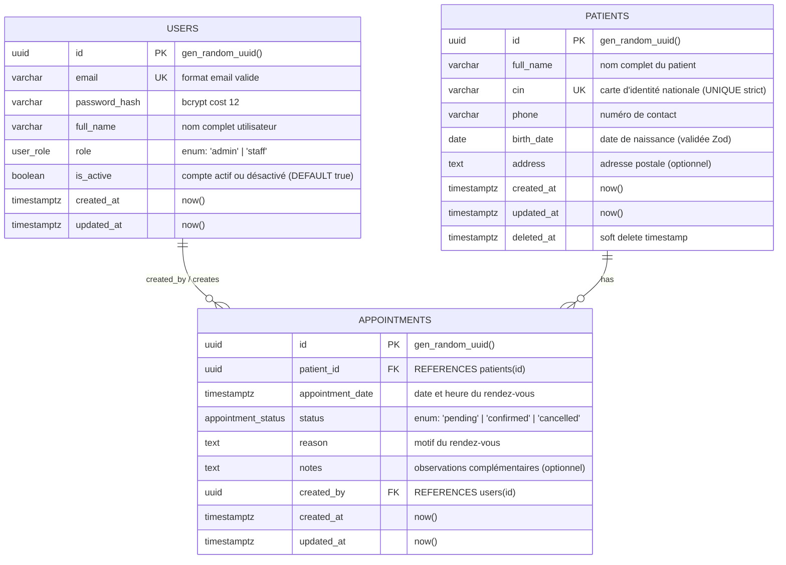

# Conception Technique & Architecture Base de Données — ClinicFlow

Ce document détaille la conception architecturale, le modèle de données, les contraintes relationnelles, les stratégies d'indexation, de concurrence et de sécurité pour l'application **ClinicFlow**.

---

## 1. Modèle Entité-Association (ERD)



---

## 2. Analyse et Justification des Relations

### 2.1 Relation `PATIENTS` ➔ `APPOINTMENTS` (1-N)
- **Type :** Un-à-Plusieurs (1 à N).
- **Justification :** 
  - Un patient peut prendre plusieurs rendez-vous au fil du temps (consultations initiales, suivis, contrôles).
  - À l'inverse, un rendez-vous donné concerne obligatoirement un et un seul patient identifié.
  - La clé étrangère `patient_id` est donc hébergée directement dans la table `appointments`.

### 2.2 Relation `USERS` ➔ `APPOINTMENTS` (1-N)
- **Type :** Un-à-Plusieurs (1 à N).
- **Justification :** 
  - Un utilisateur de la clinique (secrétaire, réceptionniste, praticien, administrateur) peut enregistrer de multiples rendez-vous dans le système.
  - Chaque rendez-vous conserve la traçabilité de son auteur (`created_by`), qui pointe vers un unique utilisateur.

### 2.3 Pourquoi n'y a-t-il pas de relation N-N (Plusieurs-à-Plusieurs) ?
- Une relation N-N (nécessitant une table de jointure associative) serait justifiée si :
  1. Un rendez-vous était une consultation de groupe réunissant plusieurs patients distincts simultanément (ex. thérapie de groupe).
  2. Un rendez-vous impliquait une équipe de plusieurs praticiens indépendants (ex. `appointment_practitioners`).
  3. Il existait une relation d'attribution durable et multiple de praticiens référents par patient indépendante des créneaux (ex. `patient_doctors`).
- **Dans le cadre clinique de ClinicFlow :**
  - Les rendez-vous sont des créneaux individuels (1 créneau = 1 patient).
  - La table `appointments` joue elle-même le rôle de table centrale d'événements reliant l'acteur du système (`users`) et le sujet du soin (`patients`).
  - L'introduction d'une table intermédiaire N-N ajouterait une complexité inutile sans justification métier.

---

## 3. Schéma Détaillé des Tables, Types et Contraintes

### 3.1 Énumérations PostgreSQL (Custom Types)

```sql
CREATE TYPE user_role AS ENUM ('admin', 'staff');
CREATE TYPE appointment_status AS ENUM ('pending', 'confirmed', 'cancelled');
```

---

### 3.2 Table `users`

| Colonne | Type PostgreSQL | Contraintes | Description |
| :--- | :--- | :--- | :--- |
| `id` | `UUID` | `PRIMARY KEY DEFAULT gen_random_uuid()` | Identifiant unique universel |
| `email` | `VARCHAR(255)` | `NOT NULL UNIQUE` | Adresse email normalisée (lowercase) |
| `password_hash` | `VARCHAR(255)` | `NOT NULL` | Hash de mot de passe (Bcrypt cost 12) |
| `full_name` | `VARCHAR(120)` | `NOT NULL` | Nom et prénom de l'agent |
| `role` | `user_role` | `NOT NULL DEFAULT 'staff'` | Rôle applicatif |
| `is_active` | `BOOLEAN` | `NOT NULL DEFAULT true` | Statut du compte (activé / désactivé). Vérifié au login |
| `created_at` | `TIMESTAMPTZ` | `NOT NULL DEFAULT now()` | Horodatage de création |
| `updated_at` | `TIMESTAMPTZ` | `NOT NULL DEFAULT now()` | Horodatage de mise à jour |

**Contraintes CHECK :**
- `CHECK (email ~* '^[A-Za-z0-9._%+-]+@[A-Za-z0-9.-]+\.[A-Za-z]{2,}$')` : Validation structurelle basique de l'adresse email.
- `CHECK (length(trim(full_name)) >= 2)` : Évite les chaînes vides ou remplies d'espaces blancs.

**Contrôle au login :**
- Lors de l'authentification (`POST /api/auth/login`), le service vérifie systématiquement que `is_active === true`. Si le compte est inactif (`is_active === false`), la requête est rejetée avec une erreur `401 Unauthorized` (message d'authentification générique).

---

### 3.3 Table `patients`

| Colonne | Type PostgreSQL | Contraintes | Description |
| :--- | :--- | :--- | :--- |
| `id` | `UUID` | `PRIMARY KEY DEFAULT gen_random_uuid()` | Identifiant unique universel |
| `full_name` | `VARCHAR(150)` | `NOT NULL` | Nom complet du patient |
| `cin` | `VARCHAR(20)` | `NOT NULL UNIQUE` | Carte d'Identité Nationale (unicité stricte) |
| `phone` | `VARCHAR(30)` | `NOT NULL` | Téléphone joignable |
| `birth_date` | `DATE` | `NOT NULL` | Date de naissance (validée Zod) |
| `address` | `TEXT` | `NULL` | Adresse physique optionnelle |
| `created_at` | `TIMESTAMPTZ` | `NOT NULL DEFAULT now()` | Horodatage de création |
| `updated_at` | `TIMESTAMPTZ` | `NOT NULL DEFAULT now()` | Horodatage de mise à jour |
| `deleted_at` | `TIMESTAMPTZ` | `NULL` | Timestamp d'archivage (Soft Delete) |

**Contraintes CHECK & Validation :**
- `CHECK (birth_date >= '1900-01-01')` : Cohérence calendaire minimale absolue.
- `CHECK (length(trim(full_name)) >= 2)` : Nom non vide.
- `CHECK (length(trim(cin)) >= 2)` : CIN non vide.
- **Validation temporelle de `birth_date` :** Pas de `CHECK (birth_date <= CURRENT_DATE)` en SQL car `CURRENT_DATE` n'est pas immuable (non déterministe lors des sauvegardes/restaurations). La vérification que la date de naissance est dans le passé est prise en charge exclusivement au niveau applicatif par Zod (`z.coerce.date().max(new Date())`).
- **Unicité stricte du CIN (Conforme au CDC) :** La contrainte `UNIQUE(cin)` s'applique sur l'intégralité de la table. Si un patient a été soft-deleted (`deleted_at IS NOT NULL`), son CIN reste réservé. Toute tentative de réinscription d'un patient avec ce même CIN est rejetée avec un code `409 Conflict`.

---

### 3.4 Table `appointments`

| Colonne | Type PostgreSQL | Contraintes | Description |
| :--- | :--- | :--- | :--- |
| `id` | `UUID` | `PRIMARY KEY DEFAULT gen_random_uuid()` | Identifiant unique universel |
| `patient_id` | `UUID` | `NOT NULL REFERENCES patients(id) ON DELETE RESTRICT` | Patient concerné |
| `appointment_date` | `TIMESTAMPTZ` | `NOT NULL` | Date et heure de début du RDV |
| `status` | `appointment_status`| `NOT NULL DEFAULT 'pending'` | Statut du rendez-vous |
| `reason` | `TEXT` | `NOT NULL` | Motif de consultation |
| `notes` | `TEXT` | `NULL` | Commentaires ou observations médicales |
| `created_by` | `UUID` | `NOT NULL REFERENCES users(id) ON DELETE RESTRICT` | Agent créateur |
| `created_at` | `TIMESTAMPTZ` | `NOT NULL DEFAULT now()` | Horodatage de création |
| `updated_at` | `TIMESTAMPTZ` | `NOT NULL DEFAULT now()` | Horodatage de mise à jour |

**Contraintes CHECK & Règles métier :**
- `CHECK (length(trim(reason)) >= 3)` : Motif significatif obligatoire.
- **Rejet des dates passées :** Lors de la création d'un rendez-vous, si `appointment_date <= now()`, la validation Zod rejette immédiatement la requête avec un code `400 Bad Request`.
- **Machine à états des transitions de statut :** Les modifications de statut (`PATCH /api/appointments/:id/status`) doivent obligatoirement respecter les transitions permises :
  - `pending` ➔ `confirmed`
  - `pending` ➔ `cancelled`
  - `confirmed` ➔ `cancelled`
  - `cancelled` est un état final définitif (aucune transition sortante permise).
  - Toute autre transition (ex. réactivation d'un RDV annulé, retour de `confirmed` vers `pending`) est rejetée avec un code `409 Conflict`.

---

## 4. Règles d'Intégrité Référentielle (ON DELETE)

| Clé Étrangère | Cible | Règle retenue | Justification détaillée |
| :--- | :--- | :--- | :--- |
| `appointments.patient_id` | `patients(id)` | **`RESTRICT`** | **Dossier médical critique :** La suppression physique en cascade (`CASCADE`) d'un patient détruirait l'historique médico-légal et les rendez-vous passés sans confirmation explicite. `RESTRICT` empêche tout effacement accidentel d'un patient tant que des rendez-vous lui sont rattachés. Dans le cadre de l'application, l'admin procède à un **soft delete** (`deleted_at`) sous réserve qu'aucun rendez-vous futur (`pending` ou `confirmed`) ne soit planifié. |
| `appointments.created_by` | `users(id)` | **`RESTRICT`** | **Traçabilité et audit d'accès :** Si un membre du personnel quitte la clinique ou voit son compte désactivé (`is_active = false`), ses actions passées (création de rendez-vous) ne doivent ni être détruites en cascade (`CASCADE`), ni perdre leur auteur (`SET NULL`), car `created_by` est `NOT NULL`. La règle `RESTRICT` force la désactivation d'un compte utilisateur plutôt que sa suppression physique. |

---

## 5. Stratégie d'Indexation et Optimisation des Performances

### 5.1 Recherche de Patients (`fullName` & `CIN`)
Dans la liste des patients, le paramètre `?search=` permet de filtrer simultanément sur le nom complet et sur le numéro de CIN.

1. **Indexation Trigramme (`pg_trgm`) :**
   Les recherches textuelles partielles ou insensibles à la casse (`ILIKE '%terme%'`) rendent les index B-Tree inopérants lorsque le terme ne commence pas au début de la chaîne.
   ```sql
   CREATE EXTENSION IF NOT EXISTS pg_trgm;

   -- Index GIN trigramme pour la recherche textuelle floue et sous-chaîne sur full_name
   CREATE INDEX idx_patients_full_name_trgm ON patients USING gin (full_name gin_trgm_ops);

   -- Index GIN trigramme sur CIN pour recherche partielle rapide
   CREATE INDEX idx_patients_cin_trgm ON patients USING gin (cin gin_trgm_ops);
   ```
2. **Index B-Tree sur `cin` :**
   La contrainte `patients_cin_key UNIQUE (cin)` génère automatiquement un index B-Tree unique standard couvrant les égalités strictes (`WHERE cin = '...'`).

### 5.2 Filtres des Rendez-vous (`appointment_date`, `status`, `patient_id`)
1. **Index Composite pour l'API et le Dashboard :**
   La route `GET /api/appointments?date=YYYY-MM-DD&status=confirmed` et les compteurs du tableau de bord exécutent des filtres combinés temporels et d'état :
   ```sql
   CREATE INDEX idx_appointments_date_status ON appointments (appointment_date, status);
   ```
2. **Index pour la fiche patient :**
   La consultation `GET /api/patients/:id` liste l'historique des rendez-vous triés par date décroissante :
   ```sql
   CREATE INDEX idx_appointments_patient_date ON appointments (patient_id, appointment_date DESC);
   ```
3. **Index Partiel pour la règle des 30 minutes :**
   Afin de vérifier quasi-instantanément l'existence de conflits pour les rendez-vous confirmés :
   ```sql
   CREATE INDEX idx_appointments_patient_confirmed ON appointments (patient_id, appointment_date)
   WHERE status = 'confirmed';
   ```

### 5.3 Prise en compte du fuseau horaire de la clinique (`CLINIC_TIMEZONE`)
Pour le calcul des métriques journalières (ex. "Rendez-vous du jour" sur le tableau de bord et le filtre `?date=YYYY-MM-DD`), l'application s'appuie sur la variable d'environnement `CLINIC_TIMEZONE` (ex. `Africa/Casablanca` ou `Europe/Paris`).
- Le serveur calcule les bornes `[startOfDay, endOfDay]` dans le fuseau horaire local de la clinique, puis les convertit en UTC pour interroger la colonne `timestamptz`.
- Cela garantit qu'un rendez-vous planifié à 23h30 heure locale reste comptabilisé dans la bonne journée clinique, indépendamment de l'heure UTC ou du fuseau du serveur d'hébergement.

---

## 6. Analyse du Soft Delete (`deleted_at`)

### 6.1 Avantages
- **Conformité & Valeur Légale :** Les données médicales ne peuvent pas être supprimées arbitrairement. Le soft delete conserve une piste d'audit intacte.
- **Réversibilité sans restauration de backup :** Possibilité d'annuler une erreur de manipulation humaine immédiatement via un simple `UPDATE ... SET deleted_at = NULL`.
- **Intégrité Référentielle Non Brisée :** Les clés étrangères (`appointments.patient_id`) continuent de pointer vers une ligne physique valide.

### 6.2 Inconvénients
- **Complexité applicative :** Toutes les requêtes de lecture doivent inclure la clause `WHERE deleted_at IS NULL`. L'oubli de ce filtre dans une requête expose des données supprimées.
- **Gestion des contraintes uniques :** Comme le CDC impose `cin UNIQUE` strict sur toute la table, un patient soft-deleted conserve son CIN réservé. Toute tentative de créer un nouveau profil avec ce même CIN retourne `409 Conflict`.
- **Volume et fragmentation :** Les données archivées restent dans les tables principales, nécessitant des index partiels si les volumes deviennent très importants.

### 6.3 Recommandation
- **Adoption ciblée du Soft Delete sur `patients` :**
  - La table `patients` comporte la colonne `deleted_at TIMESTAMPTZ NULL`.
  - La contrainte `cin UNIQUE` reste stricte et inconditionnelle.
  - Dans le code TypeScript / Drizzle, les méthodes de repository filtrent systématiquement les patients actifs (`and(eq(patients.id, id), isNull(patients.deletedAt))`).
- **Création de rendez-vous pour un patient supprimé :**
  - Si un utilisateur tente de créer un rendez-vous pour un `patientId` dont la fiche a été soft-deleted (`deleted_at IS NOT NULL`), l'API retourne immédiatement **`404 Not Found`** ("Patient non trouvé ou archivé").
- **Pour `appointments` :**
  - Pas de soft delete : le cycle de vie métier dispose déjà de l'état terminal `status = 'cancelled'`.

---

## 7. Règle Métier : "Pas 2 RDV confirmés à moins de 30 minutes pour un même patient"

### 7.1 Définition du Conflit Temporel
Deux rendez-vous confirmés $A$ et $B$ d'un patient sont en conflit si et seulement si l'écart entre leurs heures de début est **strictement inférieur à 30 minutes** :
$$| appointmentDate_A - appointmentDate_B | < 30 \text{ minutes}$$

- Deux rendez-vous espacés d'exactement 30 minutes (ex. un à 10:00 et un autre à 10:30) sont **parfaitement autorisés**.
- En SQL applicatif, la recherche de conflit exclut les bornes exactes (pas de `BETWEEN` inclusif) :
```sql
SELECT 1 FROM appointments
WHERE patient_id = $patientId
  AND status = 'confirmed'
  AND id != $currentAppointmentId -- Si update
  AND appointment_date > ($newDate - INTERVAL '30 minutes')
  AND appointment_date < ($newDate + INTERVAL '30 minutes')
LIMIT 1;
```

---

### 7.2 Comparatif des Solutions Techniques

| Option | Fonctionnement | Avantages | Inconvénients |
| :--- | :--- | :--- | :--- |
| **Option A : Advisory Lock (`pg_advisory_xact_lock`)** | Verrou transactionnel applicatif basé sur un hash de l'identifiant patient : `pg_advisory_xact_lock(hashtext(patientId::text))` | - Léger, n'écrit pas sur disque.<br>- Libéré automatiquement au `COMMIT`/`ROLLBACK`.<br>- Ne bloque que les créations relatives au patient ciblé. | - Règle appliquée uniquement si le code appelle le lock.<br>- Possibilité de collisions théoriques de hash (minime avec 64 bits). |
| **Option B : Verrou Ligne Patient (`SELECT FOR UPDATE`)** | Au début de la transaction de réservation, on exécute `SELECT id FROM patients WHERE id = $1 FOR UPDATE`. | - Standard SQL universel.<br>- Sérialise strictement toutes les modifications de RDV pour ce patient.<br>- Simple à appréhender et très robuste. | - Nécessite l'existence de la ligne patient active.<br>- Verrouille la ligne patient pendant la transaction. |
| **Option C : Contrainte d'Exclusion Postgres (`EXCLUDE USING gist`)** | Contrainte native au niveau moteur Postgres :<br>```sql<br>ALTER TABLE appointments<br>ADD CONSTRAINT no_overlapping_confirmed_appointments<br>EXCLUDE USING gist (<br>  patient_id WITH =,<br>  tsrange(<br>    (appointment_date AT TIME ZONE 'UTC'),<br>    (appointment_date AT TIME ZONE 'UTC') + interval '30 minutes'<br>  ) WITH &&<br>) WHERE (status = 'confirmed');<br>``` | - Garantie mathématique absolue au niveau moteur DB (ACID).<br>- Impossible à contourner, même par un script SQL direct.<br>- Zéro race condition possible.<br>- Déclenche l'erreur PostgreSQL standard `23P01` (`exclusion_violation`) interceptée et mappée en code HTTP `409 Conflict`. | - Nécessite l'extension `btree_gist`.<br>- Nécessite une migration SQL brute dans Drizzle.<br>- Exige des expressions `IMMUTABLE` (justifié ci-dessous). |

#### Justifications techniques approfondies sur l'Option C :
1. **Pourquoi la plage `[date, date + 30min)` et pas `±30 min` ?**
   - Modéliser une plage `[date - 30min, date + 30min]` est faux : cela doublerait artificiellement la durée d'occupation à 60 minutes au total (30 min avant ET 30 min après). Deux rendez-vous séparés de 45 minutes (par exemple 10:00 et 10:45) auraient des plages qui se chevaucheraient entre 10:15 et 10:30, provoquant un faux conflit indu.
   - En réalité, chaque rendez-vous occupe une durée de consultation de 30 minutes débutant à son heure programmée : l'intervalle semi-ouvert exact est `[appointment_date, appointment_date + interval '30 minutes')`. Deux rendez-vous entrent en collision si et seulement si leurs plages de consultation de 30 minutes se chevauchent (`&&`).
2. **Pourquoi `timestamptz + interval` n'est pas `IMMUTABLE` ?**
   - Dans PostgreSQL, le type `timestamptz` dépend du paramètre de session `TimeZone`. L'addition d'un intervalle à un `timestamptz` peut varier en fonction des transitions d'heure d'été/heure d'hiver (Daylight Saving Time), ce qui rend cette opération classée comme `STABLE` et non `IMMUTABLE`.
   - Or, les index et les contraintes `EXCLUDE` exigent des fonctions et expressions strictement `IMMUTABLE`.
   - En appliquant `(appointment_date AT TIME ZONE 'UTC')`, on convertit explicitement l'horodatage en `timestamp without time zone` sur une échelle de temps absolue et universelle. L'expression `tsrange(...)` devient ainsi rigoureusement `IMMUTABLE` et acceptée par le moteur PostgreSQL.
3. **Traduction de l'erreur PostgreSQL `23P01` :**
   - Lorsque deux requêtes concurrentes tentent d'insérer des créneaux en conflit, le moteur PostgreSQL lève l'erreur SQLState **`23P01`** (`exclusion_violation`).
   - Le middleware central de gestion des erreurs intercepte ce code d'erreur et le transforme directement en réponse HTTP standardisée **`409 Conflict`**.

---

### 7.3 Recommandation d'Architecture (Défense en Profondeur)
1. **Au niveau Service (Backend) :**
   - Exécution dans une transaction managée.
   - Verrouillage ciblé de la ressource patient avec **`SELECT id FROM patients WHERE id = $1 FOR UPDATE`**.
   - Vérification applicative par requête SQL stricte (`appointment_date > $newDate - 30min AND appointment_date < $newDate + 30min`).
   - Si un conflit est détecté, levée explicite d'une `AppError(409, "Un rendez-vous confirmé existe déjà dans une fenêtre de 30 minutes pour ce patient")`.
2. **Au niveau Base de Données (Filet de Sécurité Imperméable) :**
   - Mise en place de la contrainte d'exclusion `EXCLUDE USING gist` avec `tsrange` en UTC. Si une race condition échappe au code ou lors d'une manipulation concurrente directe, PostgreSQL bloque l'opération avec l'erreur `23P01` mappée en `409 Conflict`.

---

## 8. Spécification des Endpoints de l'API REST

### 8.1 Authentification (`/api/auth`)

| Méthode | Route | Rôles Autorisés | Statuts HTTP | Description & Validation |
| :--- | :--- | :--- | :--- | :--- |
| `POST` | `/api/auth/login` | Public | `200 OK`<br>`400 Bad Request`<br>`401 Unauthorized`<br>`429 Too Many Requests` | Connexion par email et mot de passe. Protection Arcjet (rate limit, shield, bot detection). Vérifie `is_active === true` (sinon `401`). Définit le JWT dans un cookie HTTP-Only (`httpOnly: true`, `secure: prod`, `sameSite: 'strict'`). Retourne uniquement `{ user: { id, email, fullName, role } }`. |
| `POST` | `/api/auth/logout` | `admin`, `staff` | `204 No Content`<br>`401 Unauthorized` | Déconnexion : supprime le cookie d'authentification (`res.clearCookie('token')`). |
| `GET` | `/api/auth/me` | `admin`, `staff` | `200 OK`<br>`401 Unauthorized` | Récupère le profil de l'utilisateur connecté via le cookie HTTP-Only vérifié. |

---

### 8.2 Gestion des Patients (`/api/patients`)

| Méthode | Route | Rôles Autorisés | Statuts HTTP | Description & Validation |
| :--- | :--- | :--- | :--- | :--- |
| `POST` | `/api/patients` | `admin`, `staff` | `201 Created`<br>`400 Bad Request`<br>`401 Unauthorized`<br>`409 Conflict` | Création d'un patient. Validé par Zod (`fullName`, `cin`, `phone`, `birthDate`, `address`). `409` si le CIN existe déjà dans la base (y compris si archivé). |
| `GET` | `/api/patients` | `admin`, `staff` | `200 OK`<br>`400 Bad Request`<br>`401 Unauthorized` | Liste paginée avec recherche : `?search=&page=1&limit=10`. Filtre `deleted_at IS NULL`. Retourne `{ data, pagination: { total, page, limit, totalPages } }`. |
| `GET` | `/api/patients/:id` | `admin`, `staff` | `200 OK`<br>`400 Bad Request`<br>`401 Unauthorized`<br>`404 Not Found` | Détail d'un patient actif et liste de ses rendez-vous passés et futurs. `404` si patient inexistant ou soft-deleted. |
| `PUT` | `/api/patients/:id` | `admin`, `staff` | `200 OK`<br>`400 Bad Request`<br>`401 Unauthorized`<br>`404 Not Found`<br>`409 Conflict` | Mise à jour des informations patient. `409` si le CIN modifié entre en collision. `404` si patient soft-deleted. |
| `DELETE` | `/api/patients/:id` | **`admin` uniquement** | `204 No Content`<br>`401 Unauthorized`<br>`403 Forbidden`<br>`404 Not Found`<br>`409 Conflict` | Suppression (soft delete) réservée aux admins.<br>- Si le patient a des rendez-vous futurs (`appointment_date >= now()`) avec `status IN ('pending', 'confirmed')` ➔ **`409 Conflict`** ("Impossible de supprimer un patient ayant des rendez-vous futurs en attente ou confirmés").<br>- Sinon, applique le soft delete (`deleted_at = now()`) et retourne **`204 No Content`**. |

---

### 8.3 Gestion des Rendez-vous (`/api/appointments`)

| Méthode | Route | Rôles Autorisés | Statuts HTTP | Description & Validation |
| :--- | :--- | :--- | :--- | :--- |
| `POST` | `/api/appointments` | `admin`, `staff` | `201 Created`<br>`400 Bad Request`<br>`401 Unauthorized`<br>`404 Not Found`<br>`409 Conflict` | Création d'un rendez-vous.<br>- Date passée (`appointmentDate <= now()`) ➔ **`400 Bad Request`** (Zod).<br>- Patient inexistant ou soft-deleted (`deleted_at IS NOT NULL`) ➔ **`404 Not Found`**.<br>- Règle des 30 min violée pour un statut `confirmed` ➔ **`409 Conflict`**.<br>- `createdBy` extrait du cookie JWT. |
| `GET` | `/api/appointments` | `admin`, `staff` | `200 OK`<br>`400 Bad Request`<br>`401 Unauthorized` | Liste filtrée par date (`?date=YYYY-MM-DD`) et statut (`?status=confirmed`). Les filtres par date sont interprétés selon `CLINIC_TIMEZONE`. |
| `PATCH` | `/api/appointments/:id/status` | `admin`, `staff` | `200 OK`<br>`400 Bad Request`<br>`401 Unauthorized`<br>`404 Not Found`<br>`409 Conflict` | Mise à jour du statut.<br>- Transitions autorisées : `pending ➔ confirmed`, `pending ➔ cancelled`, `confirmed ➔ cancelled`. `cancelled` est final.<br>- Transition invalide ➔ **`409 Conflict`**.<br>- Si passage à `confirmed`, vérification du conflit de 30 min (➔ **`409 Conflict`** si chevauchement). |

---

### 8.4 Dashboard & Statistiques (`/api/dashboard`)

| Méthode | Route | Rôles Autorisés | Statuts HTTP | Description |
| :--- | :--- | :--- | :--- | :--- |
| `GET` | `/api/dashboard/stats` | `admin`, `staff` | `200 OK`<br>`401 Unauthorized` | Renvoie : `{ totalPatients, appointmentsToday, pendingCount, confirmedCount }`. Les rendez-vous du jour sont délimités entre `00:00:00` et `23:59:59` selon le fuseau `CLINIC_TIMEZONE`. Ne compte que les patients actifs (`deleted_at IS NULL`). |

---

## 9. Menaces de Sécurité Majeures (OWASP Top 10) et Parades

| Menace OWASP | Risque Spécifique ClinicFlow | Parade Technique Implémentée |
| :--- | :--- | :--- |
| **A01: Broken Access Control (Contrôle d'accès défaillant)** | - Un utilisateur `staff` accède à la suppression d'un patient.<br>- Manipulation directe des identifiants (`IDOR` / `BOLA`).<br>- Falsification du champ `createdBy`. | 1. **Middleware RBAC :** `requireRole(['admin'])` placé sur `DELETE /api/patients/:id`.<br>2. `createdBy` extrait directement du payload du token JWT validé, jamais accepté depuis le body HTTP.<br>3. Validation stricte des identifiants d'URL avec Zod (`z.string().uuid()`). |
| **A02: Cryptographic Failures (Failles cryptographiques)** | - Mots de passe stockés en clair ou mal hachés.<br>- Secret JWT compromis ou faible.<br>- Fuite de données en transit. | 1. **Bcrypt** avec coût de salage élevé (`SALT_ROUNDS = 12`).<br>2. Clé secrète `JWT_SECRET` robuste (min. 32 caractères) validée au démarrage via Zod, jamais versionnée dans Git.<br>3. Expiration stricte des tokens JWT (ex. 8h). |
| **A03: Injection (Injections SQL & NoSQL)** | - Injection SQL via le champ `?search=` ou les filtres de date. | 1. **Requêtes paramétrées natives** via l'ORM Drizzle.<br>2. Aucune concaténation de chaîne de caractères SQL brute.<br>3. Schémas de validation **Zod** stricts sur tous les `req.query`, `req.params` et `req.body`. |
| **A04: Insecure Design (Conception non sécurisée / Concurrence)** | - Conflit de rendez-vous causé par deux requêtes simultanées (Race Condition). | 1. Transaction PostgreSQL sérialisée avec **`SELECT FOR UPDATE`** sur le patient.<br>2. Contrainte d'exclusion au niveau moteur base de données (`EXCLUDE USING gist`) avec `tsrange` en UTC (erreur `23P01` ➔ `409`). |
| **A05: Security Misconfiguration (Mauvaise configuration)** | - Fuite de la stack trace en production.<br>- Headers HTTP permissifs.<br>- CORS ouvert à tous les domaines. | 1. **Helmet** activé pour durcir les en-têtes HTTP (HSTS, X-Frame-Options, CSP, nosniff).<br>2. Whitelist **CORS** stricte pointant uniquement vers l'URL autorisée du front-end avec `credentials: true`.<br>3. **Middleware d'erreur centralisé** : envoi de messages standardisés (`{ success: false, message: ... }`), jamais d'exposition de stack trace si `NODE_ENV === 'production'`. |
| **A07: Identification and Authentication Failures (Authentification & Abus)** | - Attaque par force brute sur `/api/auth/login`.<br>- Énumération de comptes utilisateurs.<br>- Connexion avec un compte désactivé. | 1. **Arcjet** activé : rate limiting intelligent par IP/utilisateur, protection Arcjet Shield et détection avancée de bots/scrapers.<br>2. **Messages d'erreur génériques** : renvoyer systématiquement *"Identifiants invalides"* que l'email n'existe pas ou que le mot de passe soit faux.<br>3. Vérification du drapeau `is_active === true` au login. |
| **A08: Software and Data Integrity Failures** | - Injection de payloads JSON malicieux ou volumineux (déni de service mémoire). | 1. Limitation de taille des requêtes `express.json({ limit: '10kb' })`.<br>2. Rejet immédiat de toute propriété inattendue via `zod.strict()` ou `strip()`. |
| **Sécurité Web : Attaques XSS (Cross-Site Scripting)** | - Vol du jeton de session / JWT via injection de script client malveillant. | 1. **Cookie HTTP-Only :** Le token JWT est stocké dans un cookie avec `httpOnly: true`. Il est strictement inaccessible depuis JavaScript (`document.cookie`), neutralisant le vol de session via XSS.<br>2. En production : drapeau `secure: true` (HTTPS obligatoire).<br>3. Échappement natif des contenus côté React. |
| **Sécurité Web : Attaques CSRF (Cross-Site Request Forgery)** | - Rejeu non sollicité de requêtes authentifiées via le cookie automatique du navigateur. | 1. **Attribut SameSite :** Le cookie JWT est configuré avec `sameSite: 'strict'` (ou `'lax'`), empêchant le navigateur d'envoyer le cookie lors de requêtes cross-site tierces.<br>2. **Validation des en-têtes CORS / Origin :** Rejet de toute requête mutante (`POST`, `PUT`, `PATCH`, `DELETE`) dont l'en-tête `Origin` ou `Referer` ne correspond pas exactement au domaine de l'application front-end. |

---
*Document de conception établi conformément aux règles d'ingénierie logicielle et aux critères du test technique ClinicFlow.*
